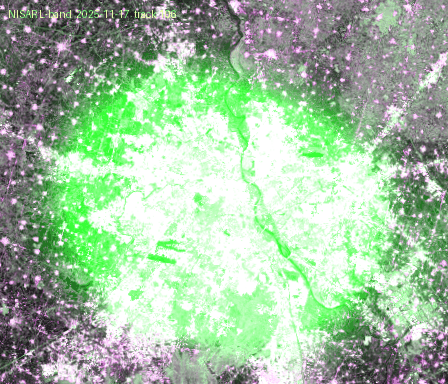

# SpaceBros · Dancing with the SARs

Team **SpaceBros** (Arkadeep Ray, Guneesh Gupta) – NASA Space Apps Challenge 2026, Delhi local event.
Challenge: [Dancing with the SARs](https://www.spaceappschallenge.org/2026/challenges/dancing-with-the-sars/) –
build an interactive app that uses **NISAR** radar data to track and visualise surface change.



## What's already here

| Path | What it is |
|---|---|
| `data/catalogue/delhi_scenes.csv` | Every NISAR GCOV (139) and GUNW (106) product over Delhi NCR, Nov 2025 → Nov 2026, with download URLs |
| `data/browse/delhi_T106/` | 28 quick-look crops of Delhi from descending track 106 (every 12 days) + `timelapse.gif` |
| `app/index.html` | Starter web viewer: map + date slider + play over 105 NISAR acquisitions on 4 tracks |
| `src/nisar_search.py` | Finds scenes for any area (no login) → CSV + `app/scenes.js` |
| `src/fetch_browse.py` | Downloads public quick-looks for one track and crops them (no login) |
| `src/gcov_subset.py` | Streams **real backscatter** (HH, HV in dB) for the study area → GeoTIFF (needs Earthdata login) |
| `src/event_scenes.py` | Catalogue + public quick-looks for any region/date window (e.g. a cyclone) – no login |
| `data/events/cyclones_bay_of_bengal_2026/` | 154 NISAR acquisitions over the Bay of Bengal, 12 Oct–6 Nov 2026 (Cyclones Arnab & Murasu) |
| `src/change_map.py` | Before/after difference map from two GeoTIFFs |
| `notebooks/01_quickstart.ipynb` | All of the above step by step (works in Google Colab) |
| `docs/SUBMISSION_CHECKLIST.md` | What we must hand in and when |

## Quick start

```bash
git clone <this repo> && cd spacebros-nisar
pip install -r requirements.txt

# 1. no login needed
python src/nisar_search.py                 # refresh catalogue (edit AOI in src/config.py)
python src/fetch_browse.py --track 106     # quick-look time-lapse

# 2. real data (free NASA Earthdata account)
python src/gcov_subset.py --track 106 --start 2026-06-01 --end 2026-10-31
python src/change_map.py data/subsets/delhi/2026-06-09_T106_HHHH.tif data/subsets/delhi/2026-09-13_T106_HHHH.tif

# 3. viewer
open app/index.html                        # or: cd app && python -m http.server
```

**Earthdata login:** register at <https://urs.earthdata.nasa.gov/users/new>. Then either let the script prompt you,
or put `machine urs.earthdata.nasa.gov login USER password PASS` in `~/.netrc`.
**Never commit credentials** (`.gitignore` already blocks `.netrc` and `.env`).

## The data, in short

- **NISAR** = NASA–ISRO L-band SAR (24 cm wavelength). Sees through clouds, day and night.
- **GCOV** (Level 2) = geocoded backscatter, ~2–9 GB per scene. Bands: `HHHH` (HH power), `HVHV` (HV power).
  HV is high over vegetation, HH is high over buildings, both are low over calm water.
- **GUNW** = geocoded interferograms → centimetre-scale ground motion (subsidence, earthquakes).
- Delhi is covered by tracks **106 & 34 (descending, frame 74)** and **55 & 156 (ascending, frame 16)**,
  each revisiting every 12 days. Compare dates **within one track** only.
- Quick-look PNGs are public and fine for visuals; for numbers, use GCOV via `gcov_subset.py`.

## Story ideas for Delhi NCR (pick one on day 1)

1. **Yamuna monsoon floodplain**: water spreads in Jul–Sep (dark in HH) then retreats. Clear, visual "dance".
2. **Crop cycle around Delhi**: kharif → harvest → rabi wheat, seen in HV. Ties to stubble burning in Oct–Nov.
3. **Urban growth / construction**: new bright HH returns (Dwarka Expressway, Noida, Jewar airport).
4. **Land subsidence** (GUNW): parts of Delhi-NCR are documented as sinking from groundwater extraction.

## Web app: "Pass by Pass"

A static page (plain HTML, CSS and JS, no build step): the dashboard in `app/dashboard-mockup/` (tabs "What happened" and "Data for officials and researchers", one Leaflet map) for the Andhra Pradesh coast (Godavari delta and the sea off it), showing what NISAR L-band radar saw around Cyclone Arnab (landfall 28 Oct 2026) and the Murasu aftermath. English only.

- **Run it:** from the repo root run `python3 -m http.server 8000`, then open <http://localhost:8000/app/dashboard-mockup/>. The GitHub Pages root redirects there. Needs internet for Leaflet, fonts, the Esri dark basemap and the live GIBS, Open-Meteo and GDACS feeds (live feeds fail soft).
- **What it reads:** `data/processed/manifest.json` (schema: `docs/MANIFEST_SCHEMA.md`), `data/processed/*.json` and the display files in `data/web/` (git-ignored, built by `tools/build_web.py`). The data of record is the 8 L-band H5 subsets in `data/h5/` (4 coast scenes of track 55, 4 sea scenes of track 48).
- **Colour coding:** radar pictures are greyscale with a per-role stretch (coast HH, sea VV); change layers use one change ramp (grey band for "no clear change", darker and brighter ends); class maps use fixed colours (new open water blue, wet or flooded crops amber, no change as a faint grey outline); a dual-pol colour composite (RGB) is available beside the grey view. Checks: `docs/review/COLOUR_CHECK.md`, `docs/review/RGB_COMPOSITE.md`.
- **Presentation switch:** `config/areas.json` `presentation.show_data_caveats` is `false`: the product shows no data-quality disclaimers, only source credits and one "not an official product, not a warning service" line. The caveats live in the pitch deck and in `docs/METHODS.md`.
- **Alerts and events:** GDACS and SACHET (Andhra Pradesh only) feed draft events. A GDACS flood alert is linked to radar passes only if its footprint is within `defaults.flood_link_km` (50 km) of the coast box; otherwise it is shown as "alert only".
- **Brief and zip download (P1):** in progress, not built yet.
- **Experimental, outside the pipeline:** `tools/experimental/mangrove_change.py` (mangrove HV-minus-HH change at Coringa; about 2 minutes and about 3 GB RAM; run `.venv/bin/python -I tools/experimental/mangrove_change.py`). Result: no detectable change; see `docs/review/MANGROVE_EXPERIMENT.md`. Not shown in the UI.

### Pipeline and tests

```bash
.venv/bin/python tools/pipeline/run_all.py --offline --skip-ingest   # catalogue, alerts, events, build_web, tests, story/findings
.venv/bin/python tools/build_web.py                                  # only the display assets from data/h5/
# the five checks run by run_all.py and pages.yml (each exits non-zero on failure):
.venv/bin/python tools/tests/test_story.py
.venv/bin/python tools/tests/test_findings.py
.venv/bin/python tools/tests/test_events.py
.venv/bin/python tools/tests/test_english_only.py
.venv/bin/python tools/check_manifest.py
```

Adding a daily scene needs `EARTHDATA_TOKEN` (ingest step only). The daily workflow `.github/workflows/update.yml` has been emulated locally (`tools/sim/`) but not run on GitHub.

### Where the docs are

`docs/STATUS.md` (live board), `docs/METHODS.md` (methods and caveats), `docs/PIPELINE.md`, `docs/DATA_STORAGE.md`, `docs/MANIFEST_SCHEMA.md`, `docs/ADDING_CONTENT.md`, `docs/PLACEHOLDERS.md` (what is still open), `docs/review/` (colour, RGB, L-band test, mangrove, acceptance, resource audit), `docs/PLAN_P1_P2.md`, `docs/REPORT_OVERNIGHT.md`, `docs/submission/` (drafts for the hand-in).

## Community & links

- Delhi WhatsApp community: <https://chat.whatsapp.com/G51kBazKRdnHrRxi5VPRoS>
- Instagram: <https://www.instagram.com/nasaspaceappsbyuwr/> · Website: <https://www.spaceappsindia.com>
- ASF Vertex (a map browser for NISAR scenes; listed as a challenge resource, not used by our code, which calls the NASA CMR API and the ASF search API) <https://search.asf.alaska.edu/> · NISAR data user guide: via the challenge Resources tab (background reading)
- Schedule: hackathon starts Sat 14 Nov 09:30 IST, ends **Sun 15 Nov 23:59 IST**

## Data credits

Built by team SpaceBros for the NASA Space Apps Challenge 2026. Not an official NASA, ISRO, IMD or government product, and not a warning service. The dashboard is called "Pass by Pass" (earlier name: "Coast Radar Watch").

Exact credit strings (use them wherever the data is shown, copied or downloaded):

- NISAR: `NISAR L2 GCOV, NASA/JPL-Caltech and ISRO, via ASF DAAC (NASA Earthdata)`, followed by scene date, track, polarisation and PROVISIONAL or VALIDATED status. Maps and numbers made by us: `SpaceBros, derived from NISAR data`.
- Alerts and storm facts: IMD / RSMC New Delhi bulletins; NDMA SACHET; GDACS (EC JRC and UN OCHA).
- Mandal outlines: geoBoundaries gbOpen India ADM3, boundary year 2018, ODbL 1.0 (attribution and share-alike; licence as reported by the geoBoundaries API, source Pathways Data Pvt. Ltd. / lgdirectory.gov.in). District names for the mandals: the 2022 Andhra Pradesh district lists (see `data/interim/C/mandal_district_2022_complete.csv`).
- Basemap: `Map data: Esri, HERE, Garmin, OpenStreetMap contributors` (Esri World Dark Gray Canvas; the line is shown in the map corner).
- Other live layers: NASA GIBS (VIIRS, IMERG, Himawari), Open-Meteo.com (CC BY 4.0), MOSDAC/SAC/ISRO link.
- Images: no NASA, ISRO or Space Apps logos or insignia, and no AI-generated images, are used. All pictures on the site are radar or map products built from the H5 files.
